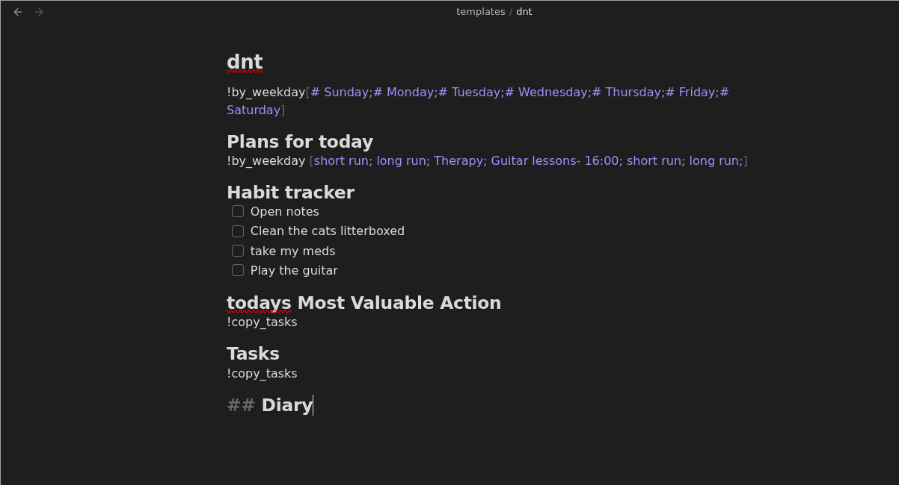
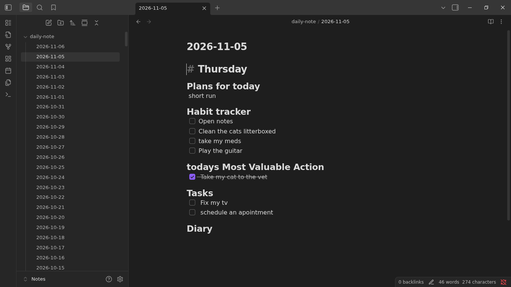
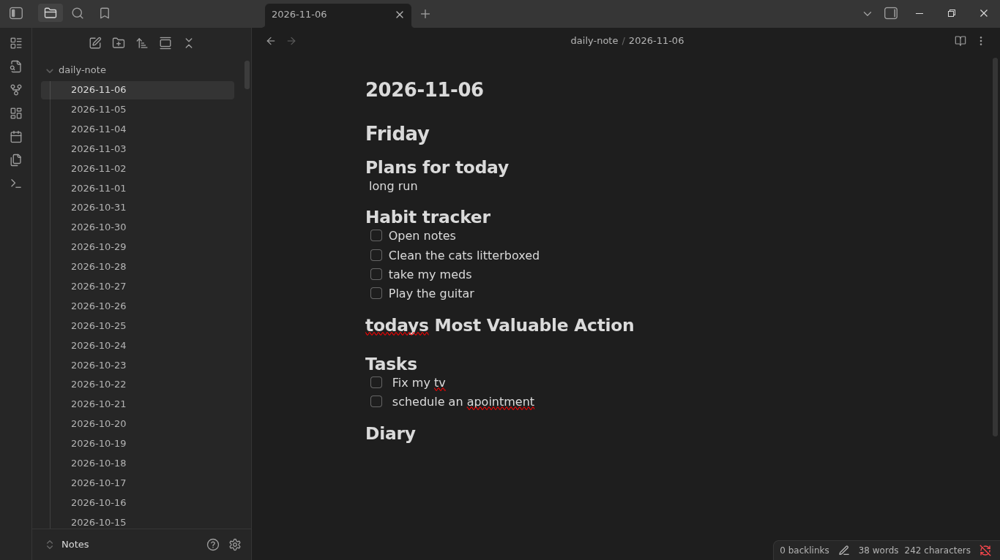

[](https://sonarcloud.io/summary/new_code?id=B3ella_bto-templater)
# Groundhog
Groundhog was built to replace the Obsidian Daily Notes plugin.

Daily notes are great but obsidian is limited to just copying the same text over and over

Groundhog can generate different text depending on the day of the week, carries forward tasks and recurring content, and integrates particularly well with NixOS

Contributions are welcome and wanted!! 
Feel free to open issues for any feature you would like or fix you need.
If you want to contribute to the project please check [contributing.md](contributing.md)
## Example
This is a cleansed version of my own daily note template

the first line tells me the day of the week

Plans for today shows my schedule for the day

the habit tracker list things I need to do every day

Todays most valuable action and tasks is where I list and prioritize the tasks I need to solve



the note generated will depend on the day of the week

On monday for example we would have


And then on tuesday the note would look like this


The !copy_tasks token ignores any completed tasks

And !by_weekday will return different content depending on the day of the week 

## Quickstart
By default grounghog will look for a template on the following path
```bash
~/Notes/templates/dnt.md
```

You can install with cargo using the following command.

```bash
cargo install --git https://github.com/B3ella/groundhog
```

If you dont already have cargo just follow the [official guide to installing rust](https://rust-lang.org/tools/install/)

Then you can run the groundhog command
```bash
groundhog
```

This will generate a daily-note with todays date in

```bash
~/Notes/daily-note/YYYY-MM-DD.md
```

if you are using obsidian just turn on obsidians daily note plugin and configure the new file location to daily-note

> ### Warning
> this assumes your vault is in ~/Notes if your vault is in any other dir, refer to the [configuration section](#configuration) and substitute ~/Notes for your vaults path


Groundhog uses the same naming convention as obsidian for its daily notes. This means every daily note feature from obsidian will work (Open next daily note, open todays daily note and open previous daily note)


Groundhog will also symlink todays daily note to
```bash
~/Notes/daily-note.md
```
This means todays daily note will always be available on this path.

If you are not using obsidian you probably want to open the symlink in your editor of choice. in my case
```bash
nvim ~/Notes/daily-note.md
```

as the path doesnt change you can alias it to a single command

```bash
notes
```

## Installation With nixos
installation with nix may seem complex but it will automatically add a systemd service that runs everyday on midnight generating the next days note.

And all you have to do is provide the groundhog url to your nixos flake

```nix
  inputs = {
    groundhog.url = "github:B3ella/groundhog";
  };
```
then enable groundhog and put your username in
```nix
      modules = [
        groundhog.nixosModules.default
        {
          services.groundhog = {
            enable = true;
            user = "bella";
          };
        }
      ];
```
## Template Syntax
By default groundhog looks for a template on ~/Notes/templates/dnt.md

to overwrite this value refer to the [configuration section](#configuration)

Groundhog processes markdown templates and supports a few special tokens.

### Copy previous section

```md
# Work
!copy_last_day
```

This copies the matching section from yesterday’s note
### Copy Tasks

```md
# Work
!copy_tasks
```
works just as copy last day, but ignores completed tasks

Completed taks are lines that start with:


```md
- [x]
```
### Weekday-specific content
```md
!by_weekday[Deep work;Admin;Planning;Meetings;Follow-ups;Review;Reset]
!by_weekday[Sunday;Monday;Tuesday;Wednesday;Thursday;Friday;Saturday]
```

This selects a value based on the current day of the week.
It expexts a list of 7 values in between square brackets separated by semicolons
The first value is the one for sunday and it goes on to saturday

## Configuration
Groundhog reads config from:

```bash
~/.config/groundhog
```

If the file does not exist, it falls back to these defaults:

```ini
template_path=~/Notes/templates/dnt.md
archive_path=~/Notes/daily-note/
symlink_path=~/Notes/daily-note.md
```

template_path is the path to the template file

archive_path is where the generate notes will be stored

symlink_path is the shortcut for the current daily note

You can override the config path with:

```bash
groundhog --config-path /path/to/config
```

## Notes
- This project currently targets Unix-like systems.
## Author
B3ella